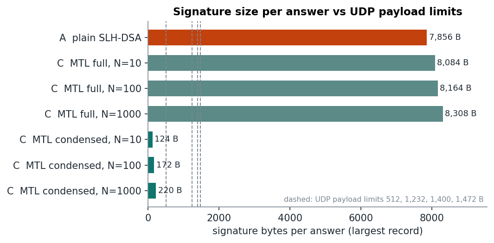
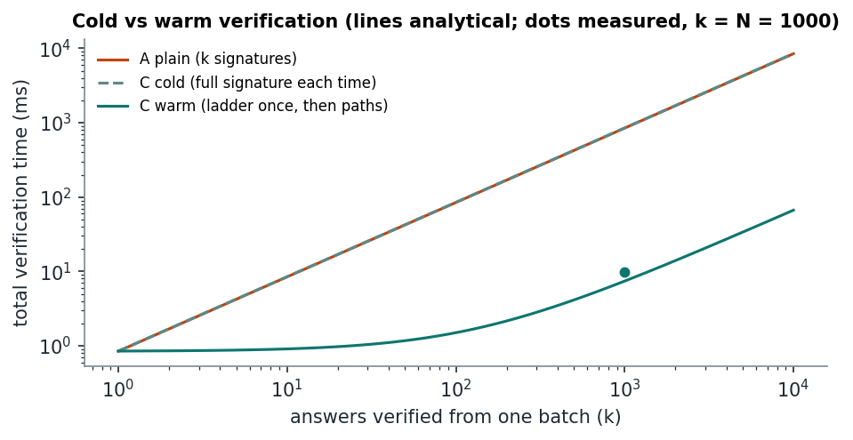
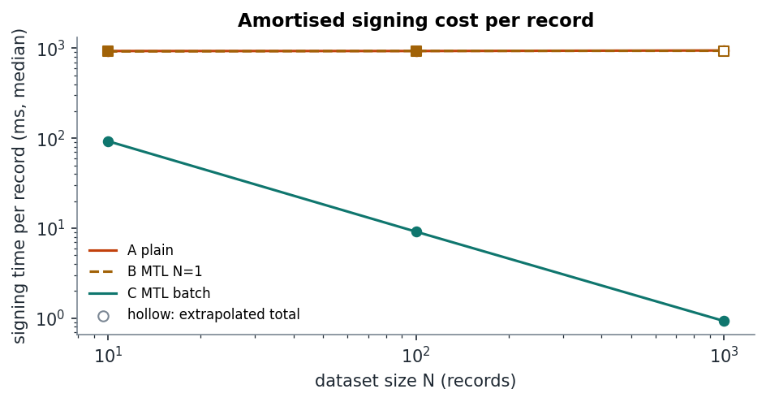
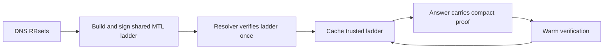
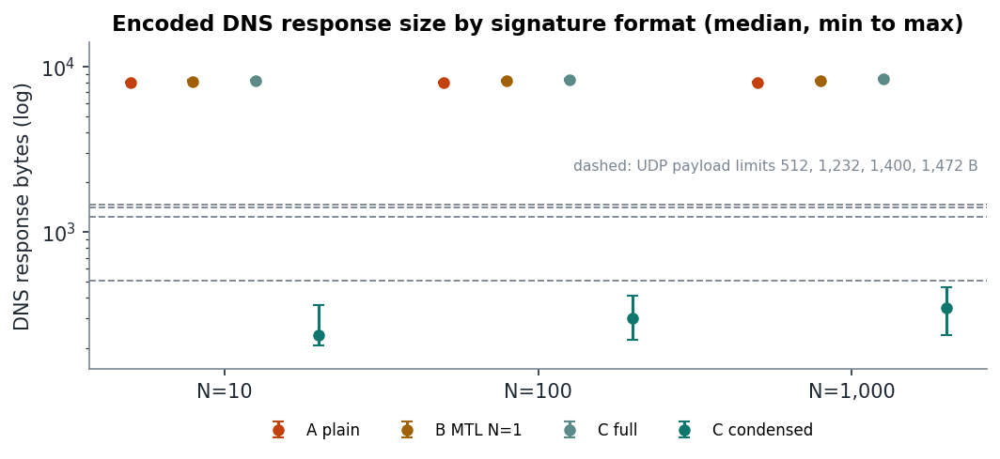
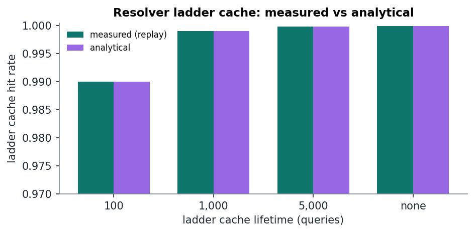

# LadderLens

<p align="center">
  <strong>Post-quantum DNSSEC, measured from signature to resolver cache.</strong><br>
  AIORI-3 · Problem Statement 036 · Team Nexora
</p>

<p align="center">
  <a href="#the-result">Explore results</a> ·
  <a href="#how-the-ladder-works">See how MTL works</a> ·
  <a href="#reproduce-the-benchmark">Run the project</a> ·
  <a href="#get-the-submission-files">Download the files</a>
</p>

<p align="center">
  
  
</p>

## The result

At 1,000 DNS RRsets, signing the full MTL batch took **929 ms**. The measured plain-SLH-DSA comparison is **944.85 seconds**, extrapolated from 100 records timed per trial. With the signed ladder already cached, MTL verification averaged **6.6 μs per answer**.

| N = 1,000 | Plain SLH-DSA | MTL batch of 1,000 |
|---|---:|---:|
| Zone signing | 944.85 s *(extrapolated)* | **929.3 ms** *(measured)* |
| Warm per-answer verification | 845.7 μs | **6.6 μs** |
| Signature material per answer | 7,856 B | **≤ 220 B** with cached ladder |
| Complete locally encoded DNS response | up to 8,100 B | **up to 464 B** with cached ladder |

<p align="center"></p>

<details>
<summary><strong>Why does the first MTL answer look different?</strong></summary>

A resolver without the ladder must fetch and verify it first. That cold MTL response reaches 8,552 B in this fixture, while the plain response reaches 8,100 B. After ladder retrieval, later answers carry only the compact proof. At N=1,000 the signed ladder takes 843.2 μs to verify once; warm per-answer verification is then 6.6 μs.

Signature-material bytes and complete DNS-message bytes are reported separately. Messages were encoded locally for size comparison; live network traffic was not captured.
</details>

## How the ladder works

MTL signs a shared structure for a batch of records. Each record gets a compact authentication proof into that signed ladder. The resolver verifies the ladder once, caches it, then checks proofs for later answers.



<details>
<summary><strong>What exactly was compared?</strong></summary>

| Arm | Workload |
|---|---|
| Plain | One SLH-DSA signature per RRset |
| MTL batch-of-one | One MTL tree for each RRset; isolates per-record MTL overhead |
| MTL full batch | One signed ladder for the zone, plus one proof per RRset |

The benchmark uses the same deterministic synthetic RRsets at N=10, 100 and 1,000. Arms are interleaved across repeated trials. The run contains 216 completed invocations and 15 cache replays. A separate cache chart shows the replay behavior.
</details>

<p align="center">
  
  
</p>

## Reproduce the benchmark

The Docker image pins OpenSSL 3.6.0, liboqs 0.16.0, and Verisign MTL v1.3.1. From the project directory:

```sh
make build
make harness
make smoke
make verify
make test
make demo
```

The image build, smoke, verification, and 21-test Docker suite passed. The retained performance measurements were collected on the recorded native WSL2 host, outside the Docker image; the manifest and full report preserve that distinction. The 1,000-record plain and MTL batch-of-one signing totals are extrapolations from 100 measured records per trial. Full-batch MTL was measured at 1,000 records.

## Get the submission files

- [Complete source, configuration, tests, presentation, and benchmark results](submission/LadderLens-A3-PS036-submission.zip)
- [Team Nexora presentation PDF](submission/AIORI-3-PS036-Nexora.pdf)
- [ZIP SHA-256 checksum](submission/LadderLens-A3-PS036-submission.zip.sha256)

## Meet the team

**A3-PS036-TC187 · Nexora** — Akshat Dubey, Aditya Goyal, and Mukesh Kumar.

[Watch our project introduction](https://youtu.be/mqXwsXCTVTw).
