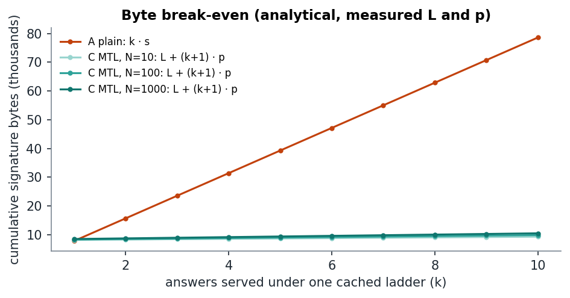

# LadderLens results: `final`

Generated by `make report`. Every number carries one tag: **measured** (read from a harness run), **extrapolated** (a measured per-record cost scaled to N), **analytical** (computed from measured inputs with the formula stated next to it) or **spec** (from a specification). Raw data, the manifest and every table are in this directory.

## Summary

- Signing 1,000 RRsets took 929.3 ms as one MTL batch (measured) against 944.85 s with plain SLH-DSA (extrapolated): one SLH-DSA signature instead of 1,000.
- With the ladder cached, a resolver verifies an answer in 6.6 µs against 845.7 µs for plain SLH-DSA (measured); the ladder itself costs 843.2 µs to check once.
- At N = 1,000, every condensed answer encodes to at most 464 B and fits 1,232 B; an answer without a cached ladder needs up to 8,552 B, more than plain SLH-DSA (8,100 B). The saving depends on ladder reuse (analytical).
- In the resolver replay with a 5,000-query ladder lifetime, 99.98% of answers were served from the cached ladder at 208 B of signature per query (measured; model 99.98%).

## Configuration

| | |
|---|---|
| Algorithm | `SLH-DSA-SHA2-128s-MTL-SHA2-128` (underlying `SLH_DSA_PURE_SHA2_128S`) |
| MTL reference | v1.3.1, commit `7cef0191da55`, built with `-O2 -g -fPIC` |
| liboqs / OpenSSL | 0.16.0 / OpenSSL 3.6.0 1 Oct 2025 |
| CPU | Intel(R) Core(TM) i3-1005G1 CPU @ 1.20GHz, 4 logical CPUs, ISA aes, avx2, avx512f, bmi2, hypervisor, sha_ni |
| Kernel / pinned image | 6.6.114.1-microsoft-standard-WSL2 / no |
| Repository commit | `unknown` |
| Workload | synthetic zone `bench.example.`, seed 36, RRset signing input 73 to 203 bytes, fixture sha256 `79774545d976e688` |
| Timer | CLOCK_MONOTONIC, noise floor 20 ns per read (median) |
| Wall clock | 163.5 min for the whole run (plan estimated 117 min) |

**The run exceeded the 120 min budget** by 43.5 min. The pilot timings that sized the plan were not reproduced under sustained load, so the planned trial counts took longer than estimated. No trial was dropped, shortened or imputed: the sample is exactly the one the plan lists. The pilot timings and the estimate are in `manifest.json` under `plan`; the time of every invocation is in `schedule.csv`.

Trials per cell (from the plan; arms interleaved in shuffled order every round):

| Arm | N | Trials planned | Trials completed | Records timed per trial |
|---|---:|---:|---:|---:|
| A: plain SLH-DSA, per record | 10 | 21 | 21 | 10 |
| A: plain SLH-DSA, per record | 100 | 21 | 21 | 100 |
| A: plain SLH-DSA, per record | 1,000 | 21 | 21 | 100 (totals extrapolated) |
| B: MTL, batch of one | 10 | 21 | 21 | 10 |
| B: MTL, batch of one | 100 | 21 | 21 | 100 |
| B: MTL, batch of one | 1,000 | 21 | 21 | 100 (totals extrapolated) |
| C: MTL, batch of N | 10 | 30 | 30 | 10 |
| C: MTL, batch of N | 100 | 30 | 30 | 100 |
| C: MTL, batch of N | 1,000 | 30 | 30 | 1,000 |

## What "transmitted bytes" means here

Three different quantities are easy to confuse, so they are kept apart:

1. **Signature material** (measured): the bytes of the plain signature, condensed signature, full signature or signed ladder that the reference library produces for an answer.
2. **Encoded DNS response** (analytical): the size of a complete DNS response carrying that signature, built and encoded locally with dnspython.
3. **Network traffic**: not measured. No server, resolver or network path is involved (PS-036 scope), so UDP/IP headers, fragmentation and TCP fallback are outside these figures.

## Signature size per answer (measured)

| N | A plain | B MTL N=1 (full) | C condensed min / median / max | C signed ladder | C full (max) |
|---:|---:|---:|---:|---:|---:|
| 10 | 7,856 B | 8,004 B | 92 B / 124 B / 124 B | 7,960 B | 8,084 B |
| 100 | 7,856 B | 8,004 B | 108 B / 172 B / 172 B | 7,992 B | 8,164 B |
| 1,000 | 7,856 B | 8,004 B | 124 B / 220 B / 220 B | 8,088 B | 8,308 B |

## DNS response size (analytical: exact encoding of a constructed response)

Question, answer RRset, one RRSIG and an EDNS(0) OPT record with DO set, encoded by dnspython. MTL signatures carry the one-octet MTL-Type prefix of draft-fregly-dnsop-slh-dsa-mtl-dnssec-06.

| N | Format | Median | Max | ≤ 512 B | ≤ 1,232 B | ≤ 1,400 B | ≤ 1,472 B |
|---:|---|---:|---:|---:|---:|---:|---:|
| 10 | A: plain SLH-DSA | 7,970 B | 8,095 B | 0% | 0% | 0% | 0% |
| 10 | B: MTL full, batch of one | 8,119 B | 8,244 B | 0% | 0% | 0% | 0% |
| 10 | C: MTL full (no ladder) | 8,199 B | 8,324 B | 0% | 0% | 0% | 0% |
| 10 | C: MTL condensed (ladder cached) | 239 B | 364 B | 100% | 100% | 100% | 100% |
| 100 | A: plain SLH-DSA | 7,990 B | 8,095 B | 0% | 0% | 0% | 0% |
| 100 | B: MTL full, batch of one | 8,139 B | 8,244 B | 0% | 0% | 0% | 0% |
| 100 | C: MTL full (no ladder) | 8,295 B | 8,404 B | 0% | 0% | 0% | 0% |
| 100 | C: MTL condensed (ladder cached) | 303 B | 412 B | 100% | 100% | 100% | 100% |
| 1,000 | A: plain SLH-DSA | 7,994 B | 8,100 B | 0% | 0% | 0% | 0% |
| 1,000 | B: MTL full, batch of one | 8,143 B | 8,249 B | 0% | 0% | 0% | 0% |
| 1,000 | C: MTL full (no ladder) | 8,435 B | 8,552 B | 0% | 0% | 0% | 0% |
| 1,000 | C: MTL condensed (ladder cached) | 347 B | 464 B | 100% | 100% | 100% | 100% |

## Signing time

Batch signing time covers every record in the dataset; key generation is reported separately. Medians over trials, with a bootstrap 95% CI where a cell has at least 20 trials.

| Arm | N | Trials | Batch signing (median) | 95% CI | Per record | Key generation | Tag |
|---|---:|---:|---:|---:|---:|---:|---|
| A: plain SLH-DSA, per record | 10 | 21 | 9.32 s | 9.03 s to 9.52 s | 932.2 ms | 117.5 ms | measured |
| A: plain SLH-DSA, per record | 100 | 21 | 93.23 s | 92.15 s to 97.11 s | 932.3 ms | 120.9 ms | measured |
| A: plain SLH-DSA, per record | 1,000 | 21 | 944.85 s | 930.81 s to 960.18 s | 944.9 ms | 122.7 ms | extrapolated |
| B: MTL, batch of one | 10 | 21 | 9.22 s | 9.12 s to 9.46 s | 922.0 ms | 1.21 s | measured |
| B: MTL, batch of one | 100 | 21 | 93.42 s | 91.48 s to 97.49 s | 934.2 ms | 12.10 s | measured |
| B: MTL, batch of one | 1,000 | 21 | 937.84 s | 920.95 s to 959.51 s | 937.8 ms | 122.76 s | extrapolated |
| C: MTL, batch of N | 10 | 30 | 927.4 ms | 909.1 ms to 942.4 ms | 92.7 ms | 120.9 ms | measured |
| C: MTL, batch of N | 100 | 30 | 914.9 ms | 896.7 ms to 936.1 ms | 9.1 ms | 122.4 ms | measured |
| C: MTL, batch of N | 1,000 | 30 | 929.3 ms | 915.0 ms to 944.6 ms | 929.3 µs | 118.9 ms | measured |

## Verification time (measured)

Single-operation latencies, verified on a context rebuilt from the public key only.

| N | A plain verify | C cold (full signature) | C ladder check (once per batch) | C warm (per record) | Warm p99 | Samples A / C warm |
|---:|---:|---:|---:|---:|---:|---:|
| 10 | 822.1 µs | 838.6 µs | 778.1 µs | 2.9 µs | 43.0 µs | 210 / 300 |
| 100 | 846.8 µs | 862.3 µs | 837.3 µs | 4.7 µs | 42.1 µs | 2,100 / 3,000 |
| 1,000 | 845.7 µs | 850.2 µs | 843.2 µs | 6.6 µs | 53.8 µs | 2,100 / 30,000 |

## Statistical comparisons

Two-sided Mann-Whitney U on per-trial values (one value per trial), because records inside a trial are not independent. A p-value needs at least three trials per side.

| N | Comparison | Median A | Median B | n A / n B | p-value |
|---:|---|---:|---:|---:|---:|
| 10 | verify time per answer: plain vs MTL warm (per-trial medians) | 826.8 µs | 2.9 µs | 21 / 30 | 1.8e-09 |
| 10 | verify time per answer: plain vs MTL cold (per-trial medians) | 826.8 µs | 814.1 µs | 21 / 30 | 0.78 |
| 10 | batch signing time: plain vs MTL | 9.32 s | 927.4 ms | 21 / 30 | 1.8e-09 |
| 100 | verify time per answer: plain vs MTL warm (per-trial medians) | 824.5 µs | 4.7 µs | 21 / 30 | 1.8e-09 |
| 100 | verify time per answer: plain vs MTL cold (per-trial medians) | 824.5 µs | 860.6 µs | 21 / 30 | 0.31 |
| 100 | batch signing time: plain vs MTL | 93.23 s | 914.9 ms | 21 / 30 | 1.8e-09 |
| 1,000 | verify time per answer: plain vs MTL warm (per-trial medians) | 831.3 µs | 6.5 µs | 21 / 30 | 1.8e-09 |
| 1,000 | verify time per answer: plain vs MTL cold (per-trial medians) | 831.3 µs | 836.1 µs | 21 / 30 | 0.86 |
| 1,000 | batch signing time: plain vs MTL (plain total extrapolated) | 944.85 s | 929.3 ms | 21 / 30 | 1.8e-09 |

## Byte break-even (analytical)

Signature bytes for k answers under one ladder. MTL pays a condensed response plus a full re-query for the first answer, then one condensed signature per answer: `L + (k+1)·p`; plain pays `k·s`. Break-even `k* = (L + p) / (s − p)`, with s, L and p measured.

| N | s (plain) | L (signed ladder) | p (median condensed) | Break-even answers |
|---:|---:|---:|---:|---:|
| 10 | 7,856 B | 7,960 B | 124 B | 1.05 |
| 100 | 7,856 B | 7,992 B | 172 B | 1.06 |
| 1,000 | 7,856 B | 8,088 B | 220 B | 1.09 |

## Cache usage: measured replay vs analytical model

One resolver replays a Zipf query stream against the reference library and caches the latest verified signed ladder. Retrieval follows the draft: condensed first, full re-query on a miss. Measured columns come from the replay; the analytical column is the model in `ladderlens/cachemodel.py`.

| Run | Queries | Records | Misses measured (mean) | Misses analytical | Hit rate measured | Signature bytes per query | Peak cache | Older-ladder hits | Compat failures |
|---|---:|---:|---:|---:|---:|---:|---:|---:|---:|
| TTL 100 queries | 20,000 | 1,000 | 200.0 | 200.0 | 0.9900 | 289 B | 8,088 B | 0 | 0 |
| TTL 1,000 queries | 20,000 | 1,000 | 20.0 | 20.0 | 0.9990 | 215 B | 8,088 B | 0 | 0 |
| TTL 5,000 queries | 20,000 | 1,000 | 4.0 | 4.0 | 0.9998 | 208 B | 8,088 B | 0 | 0 |
| no expiry | 20,000 | 1,000 | 1.0 | 1.0 | 1.0000 | 207 B | 8,088 B | 0 | 0 |
| growth, no expiry | 20,000 | 1,000 to 1,450 | 10.0 | 10.0 | 0.9995 | 231 B | 8,120 B | 1125 | 0 |

For reference, plain SLH-DSA delivers 7,856 B per query on the same stream (analytical: one signature per answer). The resolver's cache usage is the stored signed ladder (peak cache column); older-ladder hits are answers whose new authentication path verified against a ladder cached before the zone grew.

## Notes

- Per-operation figures below 200 ns (ten timer reads) would be within timer noise; check the per-record tables before quoting very small values.
- The first append on a new MTL tree includes one-time allocation (median 795.5 µs). It is part of every batch total and is why per-record figures are reported as medians.
- Rows tagged extrapolated time a subset of K records per trial and scale the total by N/K. Per-record cost in arms A and B does not depend on N, so the scaling is linear by construction.
- Arm B needs a new key per record because the MTL public API cannot reset a tree; its key generation time is reported separately and never included in signing time.
- Responses in the DNS section are constructed and encoded, not captured from a server; no resolver or network is involved (PS-036 scope).

